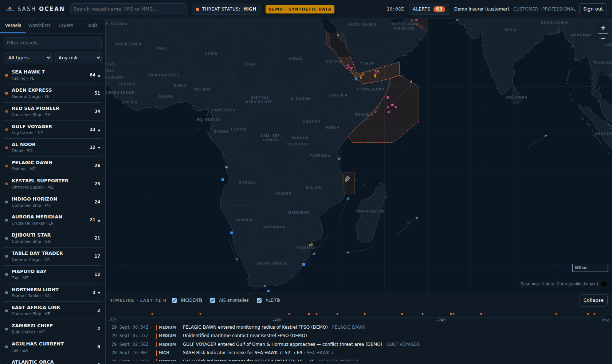
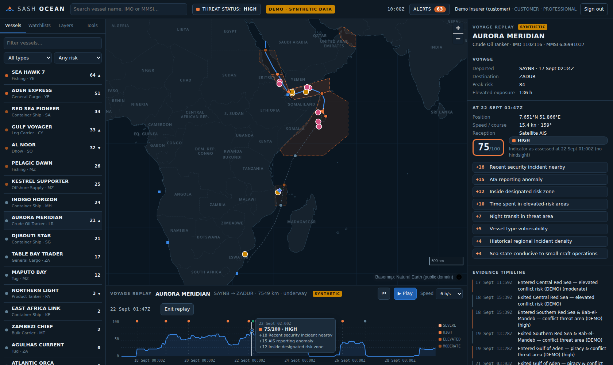

# SASH Ocean — Maritime Risk Intelligence Platform

SASH Ocean is an OSINT-first maritime situational-awareness and voyage-risk intelligence
platform. It answers one question for insurers, brokers, fleet and offshore operators,
ports and security teams:

> *What maritime assets are exposed to security risk, what is happening around them, why
> is the system concerned, and what evidence supports that conclusion?*

It is not another vessel map. The differentiator is **multi-source risk intelligence +
explainable risk scoring + behavioural anomaly detection + historical voyage analysis**,
on an architecture ready for proprietary sensor fusion (radar, EO/IR, RF, satellite and,
in the future, quantum sensors) without redesign.

> **SASH Maritime Risk Indicators provide decision-support intelligence and do not
> constitute insurance underwriting advice.** The indicator is a rules-based, explainable
> heuristic; it has not been actuarially validated.



## Quick start (Docker, ~3 minutes)

Requirements: Docker 24+ with Compose v2, 4 GB RAM free, ports 8080/8443 available.

```bash
cd sash-ocean
./scripts/init-env.sh          # creates .env with random secrets and prints the demo logins
docker compose up -d --build   # PostGIS, Redis, API, worker, gateway, Prometheus, Grafana
docker compose logs -f worker  # wait for "demo seed: {...}" (≈30–60 s on first start)
```

Open **http://localhost:8080** (or **https://localhost:8443**, self-signed certificate) and
sign in with one of the accounts printed by `init-env.sh`:

| Account | Role | What it shows |
|---|---|---|
| `customer@sash.demo` | CUSTOMER (Professional tier) | Insurer view: watchlists, alerts, Voyage Replay |
| `analyst@sash.demo` | ANALYST | Everything, incident entry, analytics triggers, reports |
| `admin@sash.demo` | ADMIN | Plus API keys, audit log, demo reseed |

API documentation: http://localhost:8080/docs · Grafana: http://localhost:3000 (admin /
`GRAFANA_ADMIN_PASSWORD` from `.env`) · Prometheus: http://localhost:9090.

Stop with `docker compose down` (add `-v` to delete data).

## The demonstration (investor / customer walkthrough)

Demo mode runs a **synthetic world** (every record flagged `SYNTHETIC`, fictional names and
identifiers) with a simulated live AIS feed: vessels move every minute and analytics re-run
every 10 minutes.

1. **Operations picture** — 23 vessels across the Red Sea, Gulf of Aden, Somali Basin,
   Mozambique Channel, South Africa, Namibia and Angola; risk zones, incidents, offshore
   assets and sensor contacts. Threat status and open alerts in the top bar.
2. Select **AURORA MERIDIAN** (crude tanker, Yanbu → Durban, on the *Insured Vessels*
   watchlist). The **Vessel Security Profile** shows the explainable **SASH Maritime Risk
   Indicator**: each contributor opens into **OBSERVATION · INFERENCE · ASSESSMENT**.
3. Press **▶ Voyage Replay**. The voyage is reconstructed and the indicator is shown *as it
   was assessed at each moment* (no hindsight):
   - enters the Central and Southern Red Sea threat areas (risk 17 → 53 → 66);
   - a skiff/ladder approach is reported near the Gulf of Aden route;
   - in the Somali Basin **AIS reporting stops for ~4 h** while two other vessels keep
     reporting nearby → *"AIS reporting anomaly"* (never "AIS disabled");
   - the vessel is ~110 km off the modelled route after AIS resumes;
   - a piracy attempt is reported ~80 km away → indicator peaks in **HIGH/SEVERE**;
   - alerts are raised with evidence and analyst actions; the vessel exits the threat areas
     and the indicator falls back to LOW approaching Durban.
4. **WHY?** explains any change as an evidence timeline, e.g.
   `22:33 AIS reporting stopped → 02:42 resumed after 4h 09m → 05:27 piracy reported
   78 km away — Risk changed: 54 → 80`, plus which contributors were added/changed.
5. **Kestrel FPSO** (northern Mozambique): radar contact **C-728** is correlated to the
   authorised supply vessel (probable identity, 94%); radar+RF contact **C-731** has no AIS
   correlation → **UNIDENTIFIED MARITIME CONTACT** (not "hostile"); a fishing vessel entering
   the 12 km monitoring radius raises an asset-approach alert.
6. **Tools** → voyage risk (e.g. Yanbu → Durban vs Cape Town → Walvis Bay) and click-anywhere
   **area risk**. Analysts can export PDF/CSV historical-exposure reports.



## What is implemented

| Area | Implementation |
|---|---|
| Data model | PostGIS schema (Alembic migration `0001`): vessels, append-only AIS observations, incidents, risk zones, events, risk assessments, alerts, watchlists, assets, sensors, contacts, fusion hypotheses, edge nodes, audit log, provenance registry |
| Provenance | Every record: source, source type, licensing category, retrieval/original time, confidence, synthetic flag. Live and synthetic data are never mixed |
| Detection | AIS gaps (adaptive cadence + peer-coverage evidence), loitering, route deviation (lane-network expected route), unexpected stops, zone entry/exit/exposure, incident proximity bands (25/50/100/250 km), identity consistency |
| Risk engine | Config-driven (`backend/config/risk_model.yaml`), point-in-time, explainable contributors, component caps, context gating, trend, confidence, config hash per result |
| Alerts | Zone entry, incident proximity, AIS gap, deviation, loitering, stop, risk increase, asset approach, dark contact — each with O/I/A evidence and a recommended *analyst* action; idempotent |
| Products | Vessel risk, Vessel Security Profile, historical exposure (PDF/CSV), Voyage Replay, area risk, voyage risk, watchlists, alerts, customer API |
| Sensors | Generic sensor model, common observation pipeline, contacts, multi-sensor correlation, reserved `QUANTUM_SENSOR` / `QUANTUM_TIMING_SOURCE` interfaces (no quantum functionality is implemented or claimed) |
| Edge | `edge/` reference agent: store-and-forward SQLite queue, link-aware priorities, backoff, gzip, NMEA AIS decoding |
| Security | Argon2 passwords, JWT, MFA-ready TOTP, lockout, RBAC (ADMIN/ANALYST/CUSTOMER/API_USER/SENSOR), tier entitlements, hashed API keys, rate limiting, audit log, TLS gateway, CSP, hardened containers |
| Ops | `/health`, `/metrics`, Prometheus, provisioned Grafana dashboard, CI (tests, lint, pip-audit, npm audit, image scan) |

## Repository layout

```
sash-ocean/
├── backend/            FastAPI app, analytics, risk engine, migrations, tests
│   ├── app/            api/ analytics/ risk/ alerts/ fusion/ connectors/ demo/ services/ ...
│   ├── config/         risk_model.yaml, detection.yaml, alerts.yaml, entitlements.yaml
│   ├── data/           ports.yaml, shipping_lanes.yaml (reference data)
│   └── tests/          unit + PostGIS integration tests
├── frontend/           React + TypeScript + MapLibre dashboard, Nginx gateway config
├── edge/               SASH Ocean Edge reference node (store-and-forward)
├── monitoring/         Prometheus + Grafana provisioning
├── scripts/            init-env.sh
├── docs/               architecture, API, security, risk model, deployment, ...
└── docker-compose.yml
```

## Development

```bash
# Backend (Python 3.11+), against any PostGIS 16 database
cd backend && python -m venv .venv && . .venv/bin/activate && pip install -r requirements-dev.txt
export DATABASE_URL=postgresql+psycopg://sash:pw@localhost:5432/sash SASH_JWT_SECRET=$(openssl rand -hex 32)
python -m app.cli migrate && python -m app.cli seed-demo --force
uvicorn app.main:app --reload --port 8000

# Frontend (Node 22)
cd frontend && npm ci && npm run dev      # http://localhost:5173, proxies /v1 to :8000

# Tests
cd backend && TEST_DATABASE_URL=postgresql+psycopg://sash:pw@localhost:5432/postgres pytest
cd edge && PYTHONPATH=. pytest
```

## Documentation

[Architecture](docs/ARCHITECTURE.md) · [Risk model](docs/RISK_MODEL.md) ·
[API](docs/API.md) · [Data sources](docs/DATA_SOURCES.md) · [Deployment](docs/DEPLOYMENT.md) ·
[Security](docs/SECURITY.md) · [Sensor integration & Edge](docs/SENSOR_INTEGRATION.md) ·
[Commercial roadmap](docs/COMMERCIAL_ROADMAP.md)

## Honest limitations of this MVP

- The risk indicator is an expert-rules heuristic with illustrative default weights; it
  must be calibrated and back-tested against real outcomes before commercial reliance.
- Demo zones, incidents and assets are **fictional**. Live operation requires licensed or
  public data (see DATA_SOURCES.md); connectors are included but disabled by default.
- Expected routes come from a coarse reference lane network — suitable for flagging large
  deviations, not for navigation.
- Analytics recompute a rolling 14-day window per run; high-volume live feeds need the
  incremental/streaming path described in ARCHITECTURE.md.
- Built-in authentication is MFA-ready; enterprise SSO (Keycloak/OIDC) is a roadmap item.
